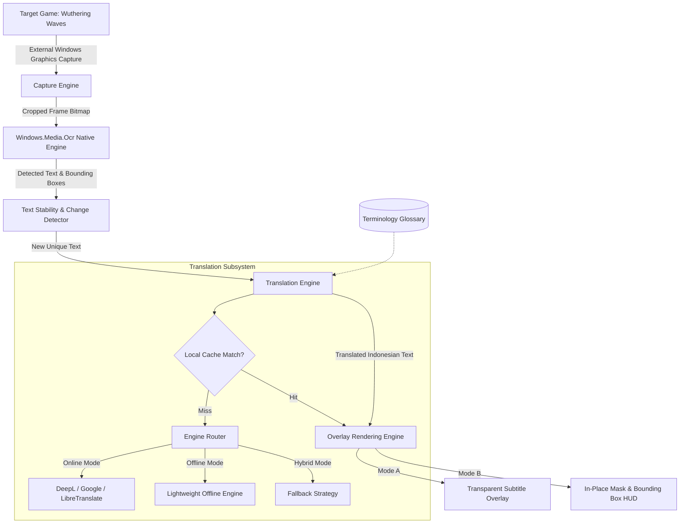

# GameLingo Architecture & System Design

## 1. System Overview

GameLingo is built as a non-invasive, ultra-lightweight game translation assistant for Windows. It is engineered with a **Zero-C-Drive-Footprint** architecture, utilizing Windows Evergreen WebView2, React, TypeScript, and a high-performance native Windows WinRT / API subsystem on Drive D. It captures video frames directly from the target game window, applies the native Windows OCR API (`Windows.Media.Ocr`), translates new dialogue lines to Indonesian, and renders subtitles or text replacement masks using an always-on-top transparent overlay.

---

## 2. Component Design

### 2.1 Native Screen Capture Subsystem
- **API**: Windows Graphics Capture (`Windows.Graphics.Capture`) / Desktop Duplication API / GDI PrintWindow fallback.
- **Window Targeting**: Locates window handle (`HWND`) by process name or window title (`Client-Win64-Shipping.exe` or `Wuthering Waves`).
- **Selective Cropping**: Captures only the user-designated region (e.g. Dialogue Box: Lower third of screen) to minimize CPU/GPU bandwidth and memory transfer.
- **Adaptive Polling Rates**:
  - *Performance Mode*: 1000 ms polling
  - *Balanced Mode*: 500 ms polling (Default)
  - *Responsive Mode*: 250 ms polling

### 2.2 OCR Engine (`Windows.Media.Ocr`)
- **Native Implementation**: Uses Windows 10/11 built-in WinRT OCR capabilities (`Windows.Media.Ocr.OcrEngine`).
- **Advantages**:
  - Zero MB external model downloads.
  - Native hardware acceleration where available.
  - Outputs structured lines, words, and exact bounding boxes (`Rect`).
- **Text Stability Algorithm**:
  - Implements Levenshtein distance and temporal debounce (2 consecutive identical frames required before dispatching translation).
  - Eliminates translation stutter during character typing animations.

### 2.3 Translation Pipeline & Hybrid Routing
- **Local Memory Cache**: In-memory LRU cache + persistent JSON file for high-frequency common phrases, dialogue choices, and menu items.
- **Terminology Glossary**: Case-insensitive dictionary replacement for Wuthering Waves proper nouns (e.g. "Resonator", "Rover", "Echo", "Jingzhou", "Tacet Discord").
- **Online Providers**: Configurable REST endpoints with strict timeout (3000 ms) and exponential backoff retry.
- **Offline Provider Interface**: Modular adapter supporting local models without hardcoding or mock strings.

### 2.4 Overlay System (WebView2 Transparent Window)
- **Always-on-top**: Window flags `WS_EX_TOPMOST`.
- **Click-Through**: Uses Windows Extended Window Style `WS_EX_TRANSPARENT | WS_EX_LAYERED` to allow all mouse clicks, drags, and keypresses to pass directly through to the game.
- **Rendering Modes**:
  - **Subtitle Overlay (Mode A)**: Bottom-centered or user-anchored customizable typography banner with high contrast outline and drop shadows.
  - **Visual Text Replacement (Mode B)**: Dynamic CSS absolute-positioned semi-opaque backdrop cards matching OCR bounding boxes, rendering Indonesian text over original English dialogue.

---

## 3. Storage & Resource Optimization Strategy

1. **Target Installed Footprint**: < 100 MB.
2. **Zero Python / Zero Heavy ML**: No PyTorch, CUDA, PaddleOCR, or heavy Hugging Face transformers.
3. **Drive D Localization**: All compiler artifacts, build caches (`target/`), and user data stored on Drive D to preserve Drive C.
4. **WebView2 Reuse**: Reuses the pre-installed Windows Evergreen WebView2 runtime, saving ~150 MB vs bundled Chromium.
